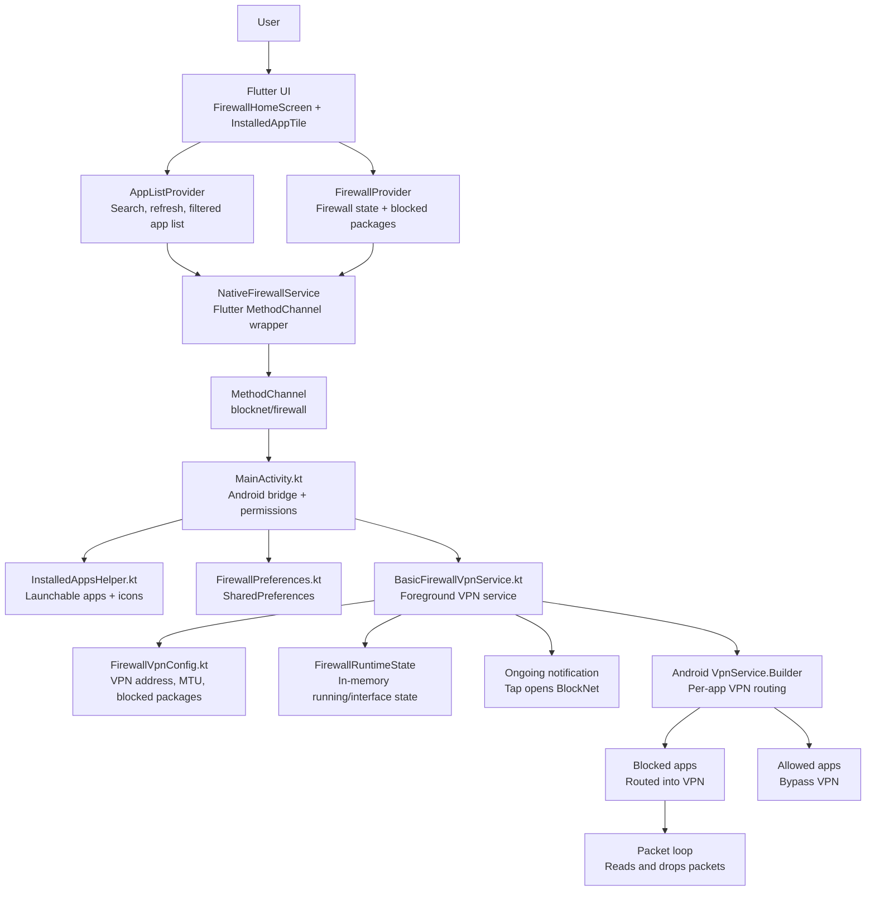

# BlockNet

BlockNet is an Android-only Flutter firewall app. It uses Android `VpnService`
to block internet access for selected installed apps without root access.

The app is intentionally local-first: blocked app selections are stored on the
device, the VPN service runs as a foreground service, and blocked traffic is
routed into a local VPN interface where it is dropped.

## Current Capability

- Lists launchable user apps with icon, app name, and package name.
- Searches installed apps.
- Filters apps by `All`, `Blocked`, and `Allowed`.
- Blocks or allows individual apps.
- Blocks all loaded apps or allows all loaded apps with one bulk action.
- Persists blocked package selections locally.
- Starts and stops a foreground Android VPN service.
- Routes blocked apps through the local VPN and drops their IPv4 traffic.
- Keeps non-blocked apps outside the VPN so their internet continues to work.
- Restores firewall status and blocked selections when BlockNet is reopened.
- Keeps blocking active when the app is removed from recents, as long as Android
  does not force-stop the app.

## Architecture Diagram



## Architecture Explanation

### 1. Flutter UI Layer

The main UI lives in `lib/screens/firewall_home_screen.dart`.

It shows:

- the current firewall status in the app bar,
- the master firewall switch,
- app search,
- `All`, `Blocked`, and `Allowed` filters,
- the `Block all` / `Allow all` bulk action,
- the installed app list.

Each app row is rendered by `lib/widgets/installed_app_tile.dart`. The switch on
each row represents whether internet is allowed for that app. When the switch is
turned off, the app package is added to the blocked package set.

### 2. Flutter State Layer

The app uses `provider` for state management.

`AppListProvider` in `lib/providers/app_list_provider.dart` owns:

- installed app loading,
- refresh state,
- search query,
- filtered app results,
- app-list loading errors.

`FirewallProvider` in `lib/providers/firewall_provider.dart` owns:

- whether the firewall is running,
- whether a firewall update is in progress,
- blocked package names,
- individual block/unblock actions,
- bulk block/unblock actions,
- firewall start/stop actions,
- native error messages.

The provider layer keeps UI code simple and gives the test suite a clean place
to verify behavior without needing a real Android VPN.

### 3. Flutter-to-Android Bridge

`NativeFirewallService` in `lib/services/native_firewall_service.dart` wraps the
Flutter `MethodChannel`.

Flutter calls these native methods:

- `getInstalledApps`
- `prepareVpn`
- `requestNotificationPermission`
- `startFirewall`
- `stopFirewall`
- `getFirewallStatus`
- `getBlockedApps`
- `updateBlockedApps`

The Dart service converts native responses into typed Dart models and throws
`NativeFirewallException` when the platform response is invalid or fails.

### 4. Android Bridge Layer

`MainActivity.kt` receives all MethodChannel calls.

Its responsibilities are:

- run installed-app scanning on a background executor,
- ask Android for VPN permission through `VpnService.prepare`,
- ask Android 13+ for notification permission,
- start and stop the foreground VPN service,
- restore firewall status,
- read and write blocked package selections,
- rebuild the VPN service when blocked apps change while the firewall is active.

This layer is deliberately thin. It coordinates Android APIs and delegates the
actual firewall behavior to `BasicFirewallVpnService`.

### 5. Installed Apps Discovery

`InstalledAppsHelper.kt` queries launchable activities using Android package
manager APIs.

It filters out:

- BlockNet itself,
- system-only apps without updates,
- non-launchable packages.

It returns:

- app display name,
- package name,
- a resized 48 px icon encoded as base64.

Icons are cached in memory on the native side to avoid repeated expensive icon
encoding during refreshes.

### 6. Persistence Layer

`FirewallPreferences.kt` stores local state in Android `SharedPreferences`.

It stores:

- `blocked_packages`: the package names currently blocked,
- `firewall_enabled`: whether the firewall should be considered active.

Package names are normalized before saving. Empty strings, invalid package names,
and BlockNet's own package name are discarded.

### 7. VPN Service Layer

`BasicFirewallVpnService.kt` is the firewall engine.

It runs as a foreground service so Android is less likely to stop it while it is
actively protecting the device. It creates an ongoing notification titled
`BlockNet active`; tapping that notification opens the app again.

When the firewall starts:

1. The service creates the notification channel if needed.
2. The service enters foreground mode.
3. `FirewallPreferences` provides the saved blocked package names.
4. `VpnService.Builder` creates a local VPN interface.
5. Each blocked package is added with `addAllowedApplication`.
6. If at least one app is routed, the service adds the IPv4 default route
   `0.0.0.0/0`.
7. A background packet loop reads packets from the VPN interface and drops them.

The name `addAllowedApplication` is an Android VPN API term. In BlockNet's
design, it means "this app is allowed to enter this VPN." Because BlockNet does
not forward packets out to the internet, any app routed into the VPN is blocked.
Apps not added to the VPN continue using normal Android networking.

### 8. Runtime State

`FirewallStateTracker.kt` keeps process-local runtime flags:

- whether the service is running,
- whether the VPN interface is established.

Persistent state still lives in `SharedPreferences`; runtime state only helps the
currently running process answer status questions quickly and avoid duplicate VPN
interface setup.

## Main Runtime Flows

### Load Apps

1. `FirewallHomeScreen` requests app loading after the first frame.
2. `AppListProvider` calls `NativeFirewallService.getInstalledApps`.
3. `MainActivity` runs `InstalledAppsHelper.getInstalledApps` on a background
   executor.
4. Android returns launchable user apps and icons.
5. Flutter sorts and displays the apps.

### Start Firewall

1. User turns on the master firewall switch.
2. `FirewallProvider` asks for VPN permission.
3. `FirewallProvider` asks for notification permission on Android 13+.
4. `MainActivity` starts `BasicFirewallVpnService`.
5. The service creates a foreground notification.
6. The service establishes the VPN interface for blocked apps.
7. Routed packets are read and dropped.

### Block or Allow One App

1. User toggles an app row switch.
2. `FirewallProvider.setAppBlocked` updates local state optimistically.
3. `NativeFirewallService.updateBlockedApps` sends the full blocked package set
   to Android.
4. `FirewallPreferences` saves the normalized set.
5. If the VPN is already running, `BasicFirewallVpnService.rebuild` recreates the
   VPN interface with the new package list.
6. If the native update fails, Flutter rolls back to the previous blocked set.

### Block All or Allow All

1. User taps `Block all` or `Allow all`.
2. `FirewallProvider.setAppsBlocked` updates the full loaded app set in one
   operation.
3. Android receives one `updateBlockedApps` call.
4. If the firewall is active, the VPN is rebuilt once.
5. If the native update fails, the previous state is restored.

### Reopen From Notification

1. User taps the ongoing BlockNet notification.
2. Android launches `MainActivity` with launcher-style flags.
3. Flutter rebuilds the UI.
4. Providers reload firewall status and blocked packages.

## Project Structure

```text
lib/
  main.dart                         App entry point and provider setup
  models/installed_app.dart         Dart model for installed apps
  providers/app_list_provider.dart  App list, search, refresh state
  providers/firewall_provider.dart  Firewall and blocked package state
  screens/firewall_home_screen.dart Main app screen
  services/native_firewall_service.dart
                                    MethodChannel wrapper
  widgets/installed_app_tile.dart   One installed app row

android/app/src/main/kotlin/com/blocknet/firewall/
  MainActivity.kt                   Flutter-to-Android MethodChannel bridge
  InstalledAppsHelper.kt            Installed app discovery and icon encoding
  FirewallPreferences.kt            SharedPreferences persistence
  FirewallVpnConfig.kt              VPN interface configuration
  FirewallStateTracker.kt           Process-local runtime status
  BasicFirewallVpnService.kt        Foreground VPN firewall service

test/
  providers/                        Provider unit tests
  services/                         MethodChannel service tests
  widgets/                          Flutter widget tests

maestro/flows/
  *.yaml                            Optional UI automation flows
```

## Requirements

- Flutter SDK
- Android SDK
- A physical Android device for real firewall validation
- USB debugging enabled on the device

An emulator can run the UI, but a physical device is preferred for validating
real app networking behavior.

## Android App Details

Application id:

```text
com.blocknet.firewall
```

App name:

```text
BlockNet
```

Primary native channel:

```text
blocknet/firewall
```

Debug APK output:

```text
build/app/outputs/flutter-apk/app-debug.apk
```

## Run Locally

From the project root:

```sh
flutter pub get
flutter run
```

Build and install the debug APK:

```sh
flutter build apk --debug
adb install -r build/app/outputs/flutter-apk/app-debug.apk
```

If more than one device is attached:

```sh
adb devices
adb -s <device-id> install -r build/app/outputs/flutter-apk/app-debug.apk
```

## Test Commands

From the project root:

```sh
flutter analyze
flutter test
flutter test --coverage
flutter build apk --debug
```

Android unit tests:

```sh
cd android
./gradlew testDebugUnitTest
```

## Optional Maestro Flows

Maestro flows live in `maestro/flows`.

From the project root:

```sh
maestro test maestro/flows/launch_app.yaml
maestro test maestro/flows/search_apps.yaml
maestro test maestro/flows/firewall_toggle.yaml
maestro test maestro/flows/block_app.yaml
maestro test maestro/flows/unblock_app.yaml
maestro test maestro/flows/persistence.yaml
```

From the `android/` folder, prefix paths with `../`:

```sh
maestro test ../maestro/flows/search_apps.yaml
```

These flows are useful for UI smoke tests. They do not prove real network
blocking.

## Real-Device Network Validation

Use a physical Android device for actual firewall validation.

1. Install and open BlockNet.
2. Confirm the app list loads.
3. Firewall OFF: verify Chrome and a target app both have internet.
4. Block one target app in BlockNet.
5. Turn firewall ON.
6. Accept the Android VPN permission prompt.
7. Accept the notification permission prompt if Android asks for it.
8. Verify the blocked target app cannot access internet.
9. Verify a non-blocked app, such as Chrome, still has internet.
10. Unblock the target app while the firewall remains ON.
11. Verify the target app has internet again.
12. Tap `Block all`.
13. Verify multiple apps lose internet access.
14. Tap `Allow all`.
15. Verify apps regain internet access.
16. Remove BlockNet from recents.
17. Verify the notification and VPN remain active.
18. Tap the notification and verify BlockNet opens normally.
19. Turn firewall OFF.
20. Verify all apps have normal internet again.

## Performance Notes

- Installed app scans run on a native background executor.
- App icons are cached and resized before being sent to Flutter.
- The refresh UI keeps the current list visible while a reload is in progress.
- BlockNet does not use wake locks.
- The VPN packet loop blocks on reads and does not spin or poll.
- Blocked-app updates rebuild the VPN only when the firewall is running.
- Bulk block/allow sends one native update instead of many per-app updates.

## Security and Privacy

- BlockNet does not require root.
- BlockNet does not send the app list to an external server.
- Blocked package names are stored locally in Android `SharedPreferences`.
- The VPN service is local. It does not forward traffic to a remote VPN server.
- Blocked traffic routed into the VPN interface is dropped.

## Known Limitations

- IPv4 blocking is implemented first.
- IPv6 blocking is not implemented yet. Full IPv6 support needs IPv6 VPN
  address/route handling and real-device validation to avoid bypasses.
- If the user force-stops BlockNet from Android settings, Android prevents the
  service from running until the app is opened again.
- Android may revoke or stop VPN services based on system policy, battery policy,
  or user action.
- Maestro UI flows verify interaction only. They do not prove real network
  blocking.

## Troubleshooting

### Package is not installed

Rebuild and install the current debug APK:

```sh
flutter build apk --debug
adb install -r build/app/outputs/flutter-apk/app-debug.apk
```

Check that the installed package id is:

```text
com.blocknet.firewall
```

### App list is empty

- Pull to refresh.
- Confirm the device has launchable third-party apps installed.
- Check `adb logcat` for package manager or permission errors.

### Firewall does not start

- Confirm the Android VPN permission prompt was accepted.
- On Android 13+, confirm notification permission was accepted.
- Check that no other VPN app is currently active.
- Reopen BlockNet and toggle the firewall again.

### Blocked app still has internet

- Confirm the app is listed as blocked in BlockNet.
- Confirm the firewall master switch is ON.
- Fully close and reopen the target app, then retest.
- Test on mobile data and Wi-Fi if possible.
- Remember that IPv6 blocking is not implemented yet.

### Notification tap opens a blank or stale screen

- Rebuild and reinstall the latest APK.
- Tap the notification again after the app has fully minimized.
- If it reproduces, collect `adb logcat` while tapping the notification.

## Development Notes

- Keep platform calls behind `NativeFirewallService`.
- Keep UI state in providers so it remains testable.
- Prefer one native update for batch operations.
- Do not add wake locks unless there is a measured need.
- Validate firewall behavior on a real Android device before considering a phase
  complete.
